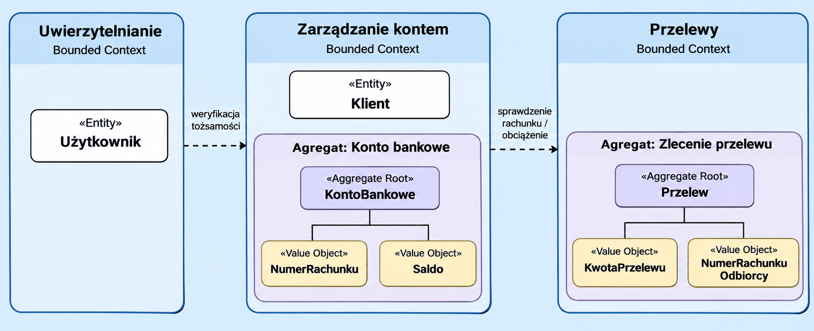

## Zadanie 1 - Domain Driven Design

**Opis zadania** Celem modelu jest przedstawienie wybranego fragmentu aplikacji bankowej: zlecenia przelewu krajowego w PLN. Model wykorzystuje Domain Driven Design, aby oddzielić uwierzytelnianie użytkownika, zarządzanie rachunkiem oraz obsługę zleceń przelewu. Uwzględniono cztery encje, dwa agregaty i dwa typy obiektów wartości, bez projektowania pełnego systemu bankowego. 

## 2. Diagram modelu

## 3. Bounded Contexts

| Kontekst | Odpowiedzialność | Zakres modelu |
|---|---|---|
| **Uwierzytelnianie** | Sprawdzenie tożsamości użytkownika zlecającego operację. | Encja `Użytkownik`. |
| **Zarządzanie kontem** | Utrzymywanie danych rachunku, sprawdzenie jego statusu, właściciela i dostępnego salda. | Encja `Klient`, agregat `KontoBankowe`. |
| **Przelewy** | Przyjęcie i walidacja zlecenia przelewu, nadanie statusu i przekazanie dyspozycji do wykonania. | Agregat `Przelew`. |

## 4. Agregaty i korzenie agregatów

| Agregat | Korzeń agregatu | Zawartość i reguły |
|---|---|---|
| **Konto bankowe** | `KontoBankowe` | Przechowuje `NumerRachunku`, saldo jako `KwotaPLN` i status rachunku. Operacje dotyczące rachunku wykonywane są przez korzeń, np. `sprawdzDostepneSrodki(kwota)` i `obciaz(kwota)`. Nie wolno obciążyć zablokowanego rachunku ani przekroczyć dostępnego salda. |
| **Zlecenie przelewu** | `Przelew` | Zawiera rachunek nadawcy i odbiorcy (`NumerRachunku`), `KwotaPLN`, tytuł oraz status. Korzeń pilnuje poprawności zlecenia i dozwolonych zmian statusu. |

**Uwaga:** Korzeń agregatu jest zarazem encją. Nie należy liczyć go jako osobnej piątej lub szóstej encji. `Klient` nie należy do agregatu `KontoBankowe` – jest osobną encją w tym samym kontekście; rachunek odwołuje się do właściciela za pomocą identyfikatora. Agregaty należące do różnych kontekstów współpracują za pośrednictwem usług aplikacyjnych / interfejsów, a nie poprzez bezpośrednie modyfikowanie cudzych obiektów.

## 5. Encje – atrybuty i ograniczenia

W modelu występują **cztery encje**:

| Encja | Przykładowe atrybuty | Ograniczenia |
|---|---|---|
| `Użytkownik` | `id: UUID`, `login: String`, `aktywny: Boolean` | `id` jest unikalny, login ma 3–50 znaków i nie może być pusty; tylko aktywny i uwierzytelniony użytkownik może zlecić operację. |
| `Klient` | `id: UUID`, `imie: String`, `nazwisko: String` | Imię i nazwisko są wymagane, mają po 1–100 znaków po usunięciu skrajnych spacji. |
| `KontoBankowe` | `id: UUID`, `wlascicielId: UUID`, `numerRachunku: NumerRachunku`, `saldo: KwotaPLN`, `status: Enum` | Numer rachunku jest unikalny; status przyjmuje `ACTIVE` albo `BLOCKED`; saldo nie jest ujemne w tym uproszczonym modelu. |
| `Przelew` | `id: UUID`, `rachunekNadawcy: NumerRachunku`, `rachunekOdbiorcy: NumerRachunku`, `kwota: KwotaPLN`, `tytul: String`, `status: Enum` | Rachunki nadawcy i odbiorcy muszą się różnić; tytuł ma 1–140 znaków; status przyjmuje `NOWY`, `WYKONANY` albo `ODRZUCONY`. |

## 6. Obiekty wartości – formaty i walidacja

Obiekty wartości nie mają własnej tożsamości; są porównywane na podstawie swoich danych i powinny być niemodyfikowalne.

| Obiekt wartości | Atrybuty / format | Reguły poprawności |
|---|---|---|
| `NumerRachunku` | `iban: String`; w tym modelu **PL + 26 cyfr** (28 znaków), np. `PL61109010140000071219812874` | Po normalizacji spacji wymagany jest polski IBAN, poprawna długość i suma kontrolna IBAN. Sam wzorzec znaków nie wystarcza. |
| `KwotaPLN` | `wartosc: Decimal`, `waluta: PLN` | Kwota ma maksymalnie 2 miejsca po przecinku. W zleceniu przelewu musi być większa od 0; dla salda może wynosić 0. Nie używa się typu `float` do obliczeń finansowych. |

## 7. Podstawowe operacje i współpraca kontekstów

1. **Uwierzytelnianie** potwierdza tożsamość aktywnego użytkownika i przekazuje jego identyfikator do procesu zlecenia przelewu.
2. **Przelewy** weryfikują numer rachunku nadawcy i odbiorcy, kwotę większą od 0 oraz tytuł przelewu.
3. **Zarządzanie kontem** sprawdza, czy rachunek źródłowy należy do odpowiedniego klienta, jest aktywny i ma wystarczające środki.
4. Po pomyślnej autoryzacji usługa aplikacyjna może zlecić obciążenie rachunku i wykonanie przelewu; w uproszczonym modelu zmienia status `Przelew` z `NOWY` na `WYKONANY`.
5. W razie błędu weryfikacji lub odmowy wykonania przelew otrzymuje status `ODRZUCONY`, a nieprawidłowe dane nie są realizowane.

**Założenie upraszczające:** Pominięto rozliczenia międzybankowe, prowizje, historię transakcji, wielowalutowość, mechanizmy księgowania i rozbudowane procesy autoryzacji. Opis dotyczy wyłącznie modelowania domeny, a nie produkcyjnej implementacji systemu finansowego.
